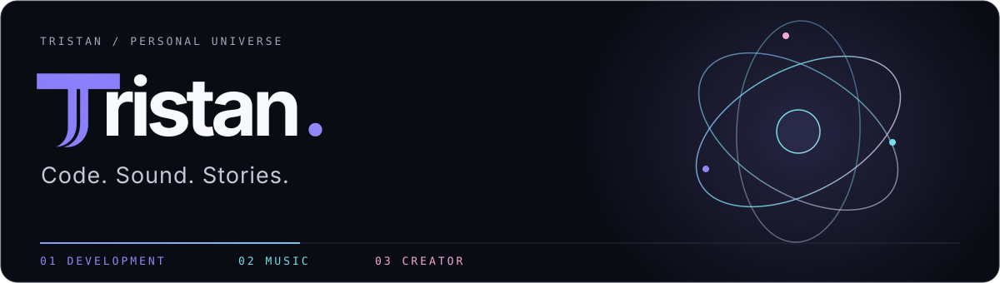

  

  Self-taught developer since 2020. Music as <strong>Vykev</strong>. Content creation, coming soon.

  
  
  

### 01 / Development

| Project                      | What it is                                                              |
| :--------------------------- | :---------------------------------------------------------------------- |
| [Kresov](https://kresov.com) | Internationalized Discord bot. Fully modular architecture. Freemium.    |
| DockerScope                  | Docker monitoring agent, container control panel and CI/CD integration. |

### 02 / Music

**Vykev** · **EP.1: Cursed** · **EP.2: ???** / coming soon.

### 03 / Creator

Coming soon.

---

### Around the web

  
  
  

  
  
  

  
  
  

### GitHub, live

  
  
  

Public GitHub counts, refreshed by Shields.io and subject to caching.

---

### This repository

Source for my bilingual portfolio: **Next.js · React · TypeScript · SCSS Modules · Three.js**.

[Development](docs/README.md) · [Content](docs/content.md) · [Deployment](docs/deployment.md) · [Sponsor API setup](docs/sponsors.md) · [License](LICENSE)
